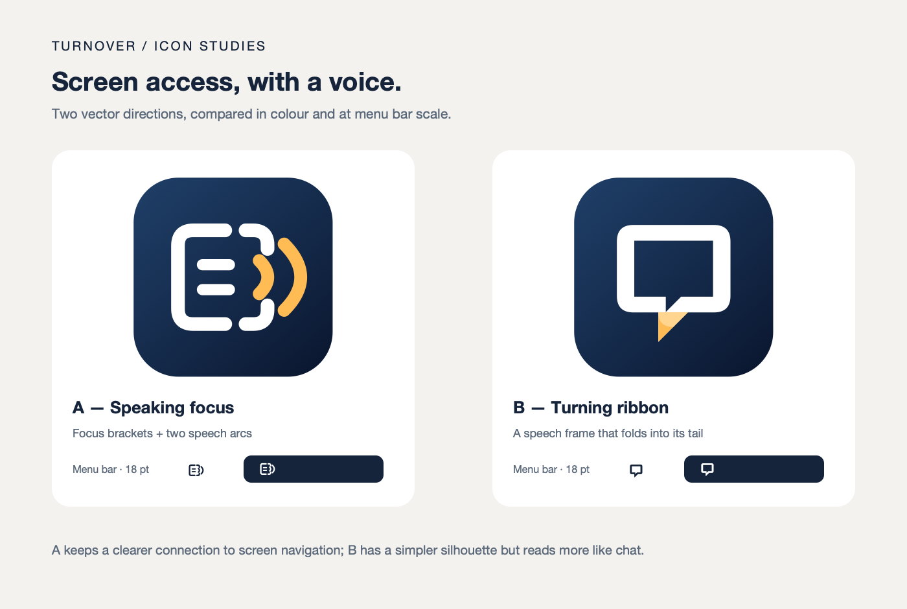
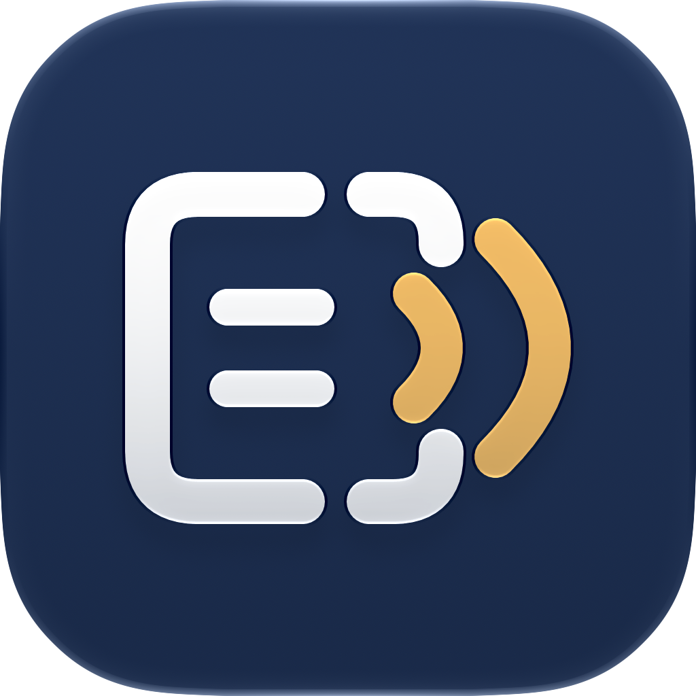

# TurnOver icons

The mark is a speaking focus cursor: a white focus frame around two short text lines, opening onto two amber
speech arcs. The frame stands for finding and navigating on-screen content; the arcs stand for spoken output.
The rounded turns connect the shape to the TurnOver name. A deep navy background keeps the white and amber clear.

Two directions were sketched before choosing this one:

The focus design retains both its navigation and speech cues at small sizes. The folded ribbon loses its fold
when reduced to a monochrome menu-bar symbol and becomes a conventional chat bubble.

## Sources and build

- `Resources/TurnOver.icon` is the editable Icon Composer document, with separate outlined SVG focus and speech
  layers in the Speaking focus group. It supports macOS, with default, dark and monochrome appearances. The dark
  appearance keeps the focus layer white. Icon Composer supplies the background, material, highlights and shadow.
- `Resources/Assets.xcassets/MenuBar.imageset/MenuBar.svg` is the same geometry in black, cropped to an 18-point
  canvas with room around the mark. It has no background or glass effects. The asset is a vector template, so
  AppKit supplies its light, dark and highlighted menu-bar colours.
- `build.sh` compiles the Composer document and asset catalog together using Xcode's `actool`. It bundles the
  resulting `Assets.car` and `TurnOver.icns`, and merges the compiler's icon metadata into the app's Info.plist.
  The `.icns` is the fallback for systems before layered icons. Both resources and the icon metadata are also
  included in the embedded TurnOver Settings app.
- `Sources/TurnOver/StatusItem.swift` loads the MenuBar image, sets its size and template rendering, and keeps
  the TurnOver accessibility label and existing menu announcements. If the image cannot load, the item displays
  the previous TurnOver text. Hovering over either version shows the TurnOver tooltip.

To edit the app icon, open `Resources/TurnOver.icon` in Icon Composer and save it. Rebuild with
`./build.sh --no-install`; generated app icons belong in the build folder, not in the source tree. If the mark's
geometry changes, update the menu-bar SVG to match, retaining the 18-point canvas and black template fill.

The vector artwork is original and is covered by the repository's GPL licence.

## Where it appears

- The TurnOver app icon appears in Finder, including Applications and Get Info, and in system surfaces that use
  its registered application icon, such as search results and application choosers.
- TurnOver remains a menu-bar app; this change does not add a Dock icon for the reader.
- The TurnOver Settings app uses the same icon in the Dock and application switcher while its window is open.
- The small monochrome mark replaces the TurnOver text in the menu bar when Show in the menu bar is enabled.
  Its accessible name remains TurnOver, and clicking it opens the existing menu.

The Icon Composer export below is the default app appearance; the operating system renders the installed icon
for the selected system appearance and size.

